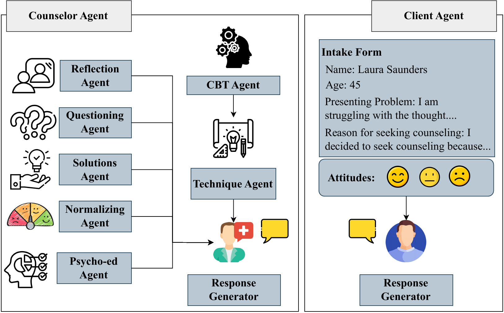

# MAGneT: Coordinated Multi-Agent Generation of Synthetic Multi-Turn Mental Health Counseling Sessions
<p align="center">

</p>

## Contact
For any questions contact: [Aishik Mandal](mailto:aishik.mandal@tu-darmstadt.de) <br>
[UKP Lab](https://www.informatik.tu-darmstadt.de/ukp/ukp_home/index.en.jsp) | [TU Darmstadt](https://www.tu-darmstadt.de/) 

## Paper and Webpage

📄 [Paper](https://aclanthology.org/2026.findings-emnlp.282/)
<br>
🌐 [Webpage](https://ukplab.github.io/emnlp2026-magnet/)

## Dataset and Model
Our dataset and model can be dowloaded [here](https://huggingface.co/collections/UKPLab/magnet). The dataset can also be downloaded at [TUdatalib](https://tudatalib.ulb.tu-darmstadt.de/handle/tudatalib/5072)

## Summary

This codebase provides the scripts used in the experiments of the 2026 EMNLP Findings paper "[MAGneT: Coordinated Multi-Agent Generation of Synthetic Multi-Turn Mental Health Counseling Sessions](https://aclanthology.org/2026.findings-emnlp.282/)". Here, we generate synthetic counseling session data using MAGneT, a novel Multi-Agent framework. MAGneT includes:
- A CBT Agent: It provides the CBT plan to be followed by the counselor during the session.
- 5 Specialized Response Generation Agents: It includes 5 agents each speclializing in a specific psychological technique, specifically: Reflection, Questioning, Solution provision, Normalizing, and Psycho-education.
- A Technique Agent: The technique agent dynamically selects the psychological techniques to be used by the counselor in the current dialogue turn based on the dialogue hiatory and CBT plan.
- A Response Generation Agent: This generates the final counselor response by combining candidate responses from specialized response agents according to the suggestions from the technique agents.

For generating the synthetic counseling sessions we employ a role-playing setup where LLM plays both the counselor and the client. Client simulations involve a detailed intake form oulining their background and issues aong with attitude towards counseling: positive, neutral or negative. We use this setup to generate 40-turn dialogue turns. For evaluation we use:

- Diversity: It measures the lexical diversity using Distinct-1, Distinct-2, Distinct-3 and Expectation Adjusted Distinct \(EAD\).
- CTRS: Cognitive Therapy Rating Scale is a psychological scale used to measure general and CBT-sprcific counseling skills.
- WAI: Working Alliance Inventory measures the therapeutic alliance between the client and the counselor.
- PANAS: Positive and Negative Affect Schedule measures the shift in positive and negative emotions after the counseling session.

## Abstract
The growing demand for scalable psychological counseling highlights the need for fine-tuning open-source Large Language Models (LLMs) with high-quality, privacy-compliant data, yet such data remains scarce. Here we introduce MAGneT, a novel multi-agent framework for synthetic psychological counseling session generation that decomposes counselor response generation into coordinated sub-tasks handled by specialized LLM agents, each modeling a key psychological technique. Unlike prior single-agent approaches, MAGneT better captures the structure and nuance of real counseling. In addition, we address inconsistencies in prior evaluation protocols by proposing a unified evaluation framework integrating diverse automatic and expert metrics. Furthermore, we expand the expert evaluations from four aspects of counseling in previous works to nine aspects, enabling a more thorough and robust assessment of data quality. Empirical results show that MAGneT significantly outperforms existing methods in quality, diversity, and therapeutic alignment of the generated counseling sessions, improving general counseling skills by $3.2$\% and CBT-specific skills by $4.3$\% on average on cognitive therapy rating scale (CTRS). Crucially, experts prefer MAGneT-generated sessions in $77.2$\% of cases on average across all aspects. Moreover, fine-tuning an open-source model on MAGneT-generated sessions shows better performance, with improvements of $6.3$\% on general counseling skills and $7.3$\% on CBT-specific skills on average on CTRS over those fine-tuned with sessions generated by baseline methods.

## Creating the environment

To create the environment for Inference and Evaluation (i.e. run scripts in folder src/ and evaluation/) use:

```
python3 -m venv env
source env/bin/activate
pip install -r requirements_inf_eval.txt
```

To create the environment for Qlora Fine-tuning (i.e. run scripts in folder qlora/) use:

```
python3 -m venv env
source env/bin/activate
pip install -r requirements_qlora.txt
```

## Code Structure

Folders in the code base:

- dataset: Contains the inital seeds, i.e., the client intake forms for generating the synthetic therapy sessions and the data generated by MAGneT using this initial seeds.
- prompts: Contains prompts for the various agents used in generating synthetic theraoy sessions using CACTUS, Psych8k, MASCS-Gen and its ablation and Qlora fine-tuned Llama3-8B-Instruct models.
- evaluation: Contains 4 folders corresponding to Diversity evaluation and quality evaluation via CTRS, WAI and PANAS.
- src: Contains scripts for generatig synthetic theraoy sessions using CACTUS, Psych8k, MASCS-Gen and its ablation and Qlora fine-tuned Llama3-8B-Instruct models.
- qlora: Contains scripts for Qlora fine-tuning Llama3-8B-Instruct model using the synthetic data generated by CACTUS, Psych8k and MASCS-Gen.

**Further details on running the scripts are provided in each folder**

## Cite

Please use the following citation:

```
@inproceedings{mandal-etal-2026-magnet,
    title = "{MAG}ne{T}: Coordinated Multi-Agent Generation of Synthetic Multi-Turn Mental Health Counseling Sessions",
    author = "Mandal, Aishik  and
      Chakraborty, Tanmoy  and
      Gurevych, Iryna",
    editor = "Lee, Hung-Yi  and
      Dev, Sunipa  and
      Li, Jessy  and
      Elliott, Desmond",
    booktitle = "Findings of the {A}ssociation for {C}omputational {L}inguistics: {EMNLP} 2026",
    month = oct,
    year = "2026",
    address = "Budapest, Hungary",
    publisher = "Association for Computational Linguistics",
    url = "https://aclanthology.org/2026.findings-emnlp.282/",
    doi = "10.18653/2026.findings-emnlp.282",
    pages = "5934--5983",
    ISBN = "979-8-89176-462-0",
    abstract = "The growing demand for scalable psychological counseling highlights the need for high-quality, privacy-compliant data, yet such data remains scarce. Here we introduce MAGneT, a novel multi-agent framework for synthetic psychological counseling session generation that decomposes counselor response generation into coordinated sub-tasks handled by specialized LLM agents, each modeling a key psychological technique. Unlike prior single-agent approaches, MAGneT better captures the structure and nuance of real counseling. We further propose a unified evaluation framework that consolidates diverse automatic metrics and expands expert assessment from four to nine counseling aspects, thus addressing inconsistencies in prior evaluation protocols. Empirically, MAGneT substantially outperforms existing methods: experts prefer MAGneT-generated sessions in 77.2{\%} of cases on average across the nine aspects over the strongest baseline, and sessions generated by MAGneT using Llama3-8B-Instruct backbone yield 3.2{\%} higher general counseling skills and 4.3{\%} higher CBT-specific skills on cognitive therapy rating scale (CTRS). An open source Llama3-8B-Instruct model fine-tuned on MAGneT-generated data also outperforms models fine-tuned using baseline synthetic datasets by 6.9{\%} on average on CTRS. We make our code, data and fine-tuned model public."
}
```

## References/Libraries

- [DeepSpeed](https://www.deepspeed.ai/)
- [vLLM](https://docs.vllm.ai/en/latest/)
- [HuggingFace](https://huggingface.co/)
- [LangChain](https://www.langchain.com/)
- [cactus](https://github.com/coding-groot/cactus)

## Disclaimer

> This repository contains experimental software and is published for the sole purpose of giving additional background details on the respective publication. 
